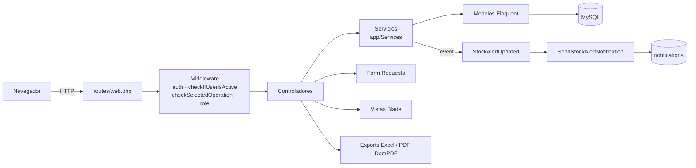
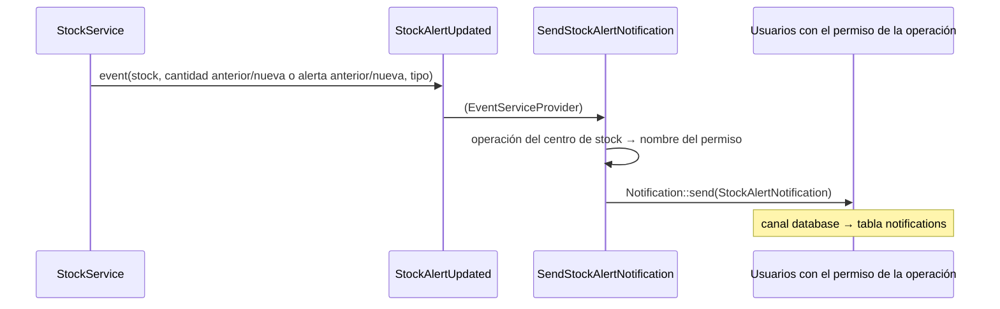

# Arquitectura

StockSystem es un monolito Laravel 9 con vistas renderizadas en el servidor (Blade). No hay SPA: cada pantalla es una ruta web que devuelve HTML, con algo de jQuery y `fetch` para interacciones puntuales (filtro de artículos, provincias, contador de notificaciones).

## Estructura de carpetas

| Ruta | Contenido |
|------|-----------|
| `app/Http/Controllers/` | Controladores web. `Auth/` son los de `laravel/ui`. `api/ApiCountryController.php` sirve países y provincias. |
| `app/Http/Middleware/` | Middleware estándar más `CheckIfUserIsActive`, `CheckSelectedOperation`, `JwtMiddleware` y `Cors`. |
| `app/Http/Requests/` | Form Requests de validación: `ArticleRequest`, `ReferRequest`, `StockRequest`, `MovementRequest` (este último no se usa). |
| `app/Services/` | Lógica de negocio: remitos, movimientos, stock, artículos, dashboard y reportes. |
| `app/Models/` | Modelos Eloquent. |
| `app/DTOs/` | Objetos de transferencia: `MovementData` (se usa) y `ReferStatusData` (no se usa). |
| `app/Events/`, `app/Listeners/`, `app/Notifications/` | Alertas de stock y notificaciones internas. |
| `app/Exports/` | Exportaciones a Excel con `maatwebsite/excel`. |
| `app/Helpers/` | `helpers.php` (funciones globales, autocargado por Composer) y `StockHelper` (fachada estática sobre `StockService`, sin uso). |
| `app/Charts/` | `RetiredArticles` (clase de `consoletvs/charts` sin uso; los gráficos usan Chart.js por CDN). |
| `database/migrations/` | Esquema de la base. Ver [Modelo de datos](modelo-de-datos.md). |
| `database/seeders/` | `DatabaseSeeder`: roles, permisos, operaciones y usuarios de prueba. |
| `database/data/countries.json` | Países y provincias que usa el formulario de direcciones. |
| `resources/views/` | Vistas Blade, una carpeta por módulo. |
| `resources/js/`, `resources/sass/` | Assets compilados con Vite. |
| `.docker/` | Dockerfile de PHP y configuración de Nginx. |
| `.idx/` | Entorno de Firebase Studio. |

## Ciclo de un request

1. **Middleware global** (`app/Http/Kernel.php`): proxies, CORS de Laravel, modo mantenimiento, tamaño del POST, trim y conversión de strings vacíos a `null`.
2. **Grupo `web`**: cookies, sesión, errores de validación, CSRF y *route model binding*.
3. **Middleware de ruta**, en este orden para casi todas las pantallas:
   - `auth`: exige sesión iniciada; si no la hay, redirige a `/login`.
   - `checkIfUserIsActive` (`CheckIfUserIsActive`): si `users.is_active` es falso, cierra la sesión y redirige al login con el mensaje *"Tu cuenta está inactiva."*.
   - `checkSelectedOperation` (`CheckSelectedOperation`): si en la sesión no hay `selected_operation`, o la que hay ya no está entre las operaciones permitidas del usuario, la descarta y redirige a `/operation-select`. Los usuarios con rol `tecnico` están exceptuados.
   - `role:admin` / `role:tecnico` (Spatie): restringe los grupos de administración y del portal técnico.
4. **Controlador**, que delega en un servicio (en los módulos refactorizados) o trabaja directo con Eloquent (en los ABM más viejos).
5. **Respuesta**: vista Blade, redirección con mensaje *flash* (`success`, `error`, `mensaje`), PDF en streaming, descarga Excel o JSON.

Detalle de qué rutas lleva cada middleware: [Rutas](rutas.md).

## Controladores

Conviven dos estilos:

- **Refactorizados (controlador delgado + servicio + Form Request):** `ArticleController`, `ReferController`, `MovementController`, `StockController`, `HomeController`, `NotificationController`. Usan inyección de dependencias por constructor y argumentos con nombre.
- **ABM clásicos (Eloquent directo + `$this->validate`):** `PersonController`, `DirectionController`, `StockcenterController`, `OperationController`, `AdminController`, `ImportController`, `TechnicalController`. Definen reglas y mensajes en propiedades estáticas.

| Controlador | Responsabilidad |
|-------------|-----------------|
| `HomeController` | Dashboard (`/home`), selección de operación, manual de uso, reportes Excel de movimientos y consumo. |
| `ArticleController` | ABM de artículos y endpoint JSON `GET /api/article` para filtrar artículos en la carga de remitos. |
| `PersonController` | ABM de personas (en la interfaz figuran como "Técnicos"). |
| `DirectionController` | ABM de direcciones; arma la lista de países llamando a `ApiCountryController`. |
| `StockcenterController` | ABM de centros de stock. |
| `ReferController` | ABM de remitos y transiciones de estado (emitir, finalizar, cancelar), PDF del remito. |
| `MovementController` | Listado de movimientos, carga masiva de artículos en un remito, vista de tránsito. |
| `StockController` | Listado y detalle de stock, edición del nivel de alerta, exportación PDF/Excel. |
| `NotificationController` | Marcar como leídas, borrar y contar notificaciones. |
| `OperationController` | ABM de operaciones y su configuración (`OperationConfig`); al crear una operación crea también el permiso homónimo. |
| `AdminController` | Gestión de usuarios: rol, permisos, estado activo y centro de stock asignado. |
| `ImportController` | Importación CSV de artículos, personas y direcciones. |
| `TechnicalController` | Portal del técnico: dashboard, solicitud de materiales y reporte de consumo. |
| `UserController` | Login por JWT para la API y usuario del token (ver [problemas conocidos](problemas-conocidos.md)). |
| `PermissionController` | Esqueleto vacío, sin rutas. |

## Servicios (`app/Services`)

Se resuelven con el contenedor de Laravel (inyección en constructores o `app(Servicio::class)`).

### `ReferService`
Ciclo de vida de los remitos. Depende de `StockService`.

| Método | Qué hace |
|--------|----------|
| `paginateRefers(origen, destino, estado, destinosPermitidos, porPágina)` | Listado filtrado; `'*'` o vacío significa "todos". Restringe a los destinos permitidos si la colección no está vacía. |
| `createRefer(data)` | Crea el remito con estado `I`, `date_up` (por defecto, ahora) y `id_user` del usuario logueado, dentro de una transacción. |
| `updateRefer(id, data)` | Actualiza la carátula; ignora `status` a propósito. |
| `emitRefer(id)` | `I → E`. Exige al menos un movimiento. Descuenta stock del origen salvo que sea proveedor (`P`). |
| `finalizeRefer(id, fecha?)` | `E → F`. Acredita stock en el destino salvo que sea consumo (`C`). Guarda `date_ended`. |
| `cancelRefer(id)` | `I/E → C`. Si estaba emitido, repone el stock del origen con `restoreOriginStock`, salvo que sea proveedor (`P`). |
| `getArticlesWithStockInfo(referId)` | Todos los artículos con la cantidad disponible en el origen del remito. |
| `getAvailableOrigins(operaciones)` | Pensado para limitar los orígenes a las operaciones permitidas. Hoy no tiene efecto: compara IDs de operación con nombres y el formulario no usa el resultado. |
| `getReferWithMovements`, `getReferForPdf`, `findRefer`, `getAllStockcenters` | Consultas auxiliares. |

### `StockService`

| Método | Qué hace |
|--------|----------|
| `adjustStock(refer, movimientos, aumentar)` | Elige el centro (destino si aumenta, origen si descuenta) y delega en `adjustStockcenter`. |
| `adjustStockcenter(centro, movimientos, aumentar)` | Núcleo de la actualización de stock. Por cada movimiento: marca `transit` (verdadero al descontar, falso al acreditar), busca o crea el registro de `stocks` del centro, suma o resta la cantidad **con piso en 0** y dispara `StockAlertUpdated`. |
| `increaseStock` / `decreaseStock` | Atajos de `adjustStock`: acreditan el destino (al finalizar) o descuentan el origen (al emitir). |
| `restoreOriginStock(refer, movimientos)` | Acredita el **origen** y saca los movimientos de tránsito. Se usa al cancelar un remito emitido. |
| `filterStocks`, `paginateStocks` | Stock filtrado por centro, tipo, nombre y código de artículo. |
| `findStock`, `getStockMovements` | Detalle de un stock y los movimientos de ese artículo con ese centro como origen o destino. |
| `updateQuantityAlert(id, alerta)` | Cambia `quantity_alert` y dispara `StockAlertUpdated` de tipo `alert`. |
| `getAvailableStockcenters()` | Centros que no son proveedor ni consumo. |
| `getStockSummary` | Resumen de stock (sin uso). |

### `MovementService`
Listado paginado de movimientos, `processBatchMovements` (crea, actualiza y borra los renglones de un remito en una sola pasada, usando el DTO `MovementData`), y `getTransitMovements` (movimientos de remitos emitidos agrupados por remito, con paginación manual).

### `ArticleService`
ABM de artículos y `filterArticles` para el endpoint JSON del buscador.

### `DashboardService`
Métricas del dashboard: resumen, rotación, stock sin movimiento, eficiencia de despacho, recomendaciones y movimientos recientes para el gráfico. Definiciones en [Flujos de negocio](flujos-de-negocio.md#dashboard).

### `ReportService`
Consultas que alimentan las exportaciones Excel: `getStockReport`, `getMovementReport`, `getConsumptionReport` y `getReportSummary` (encabezado con totales, fecha y usuario).

## Funciones globales (`app/Helpers/helpers.php`)

| Función | Devuelve |
|---------|----------|
| `get_selected_operation()` | El nombre de la operación activa (`session('selected_operation')`). |
| `get_allowed_operations()` | Colección de `Operation` (solo `name`) cuyos nombres coinciden con algún permiso del usuario. |
| `get_allowed_operations_list()` | Lo mismo, pero solo los nombres. |
| `x_fecha_español($fecha)` | Fecha como "dd de mes" usando `strftime` (deprecado en PHP 8.1). |

Las dos funciones de operaciones primero buscan `session('allowed_operations')`, que nunca se setea, así que siempre consultan la base.

## Eventos y notificaciones

- `StockAlertUpdated` se dispara en dos casos: cada vez que `adjustStock` modifica un registro de stock (tipo `quantity`) y cada vez que se cambia el nivel de alerta (tipo `alert`). No se transmite por broadcasting aunque declare un canal.
- `SendStockAlertNotification` busca la operación del centro de stock y notifica a **todos** los usuarios que tengan el permiso con ese nombre, ya sea directo o por rol.
- `StockAlertNotification` guarda en `notifications.data`: `stock_id`, `article_id`, `article_name`, `stockcenter_id`, `stockcenter_name`, `message`, `quantity`, `quantity_alert` y `url`.
- Se notifica cualquier cambio, no solo cuando el stock cae bajo la alerta.
- La campana de la barra superior (`layouts/notificationbox.blade.php`) muestra las últimas 20 notificaciones y consulta `GET /notifications/count` para el contador.

`Notificationalert` y `App\Notifications\NotificationController` son restos de una implementación anterior y no se usan.

## Frontend

### Layout

- `layouts/app.blade.php`: esqueleto HTML. Incluye `@vite(['resources/sass/app.scss', 'resources/js/app.js'])`, Boxicons y Nunito por CDN, y jQuery 3.5.1 al final del `body`. Expone las secciones `css`, `content` y `js`.
- `layouts/newNavbar.blade.php`: barra superior y menú lateral. Solo se muestra si hay una operación elegida. El menú cambia según el rol: el técnico ve "Mi Dashboard"; el resto ve los módulos de stock; las entradas de administración (Usuarios, Operaciones, Importar) aparecen solo si la operación activa es `ADMIN`.
- `layouts/movementbox.blade.php`: desplegable con los remitos en tránsito. Llama a `MovementService::getTransitMovements(100)` desde la vista en cada página.
- `layouts/notificationbox.blade.php`: desplegable de notificaciones con acciones por `fetch`.
- `layouts/alert.blade.php`: mensajes *flash*.
- `layouts/navbar.blade.php`: barra anterior, ya no se incluye.

### Vistas por módulo

`article/`, `person/`, `direction/`, `stockcenter/`, `operation/`, `refer/`, `movement/` y `stock/` siguen el patrón `index`, `create`, `edit`, `show` y un `form` parcial compartido. Además:

- `home.blade.php` y `home/`: dashboard (`alerts`, `reports`, `graphMovements`), selector de operación (`operationSelect`) y manual de usuario (`howtouse`).
- `technical/dashboard.blade.php`: portal del técnico.
- `admin/user/`: gestión de usuarios.
- `import/create.blade.php`: importación CSV, con las instrucciones de formato.
- `refer/pdf.blade.php` y `stock/pdf.blade.php`: plantillas para DomPDF.
- `exports/`: plantillas HTML de reportes (las exportaciones actuales arman el Excel por código y no las usan).

### JavaScript

| Archivo | Uso |
|---------|-----|
| `resources/js/app.js` | Importa `bootstrap.js` (Bootstrap, Axios, Lodash) y alterna el menú lateral. |
| `resources/js/functions/movement.js` | Pantalla `movement/create`: agrega los artículos marcados a la tabla del remito, marca renglones para borrar y filtra artículos por AJAX contra `GET /api/article`. Usa las variables globales `route` y `refer` que define la vista. |
| `resources/js/ajax/state.js` | Al elegir país, carga las provincias desde `GET /api/state/{país}`. |
| `resources/js/ajax/generatepdf.js` | Previsualización del PDF de stock en un iframe. Tiene la URL `http://stocksystem.com` fija en el código. |

Los gráficos del dashboard usan Chart.js por CDN (`cdn.jsdelivr.net/npm/chart.js`).

## PDF y Excel

- **PDF** (`barryvdh/laravel-dompdf`, alias `PDF`): `ReferController::getPdf` renderiza `refer/pdf` y `StockController::getPdf` renderiza `stock/pdf` con los mismos filtros del listado. Ambos se devuelven en streaming (`stream`).
- **Excel** (`maatwebsite/excel`): las clases de `app/Exports` implementan `FromCollection`, `WithHeadings`, `WithMapping`, `WithEvents` y `WithCustomStartCell`. Los datos arrancan en la fila 8; las filas 1 a 7 llevan título, fecha y usuario, filtros y resumen, que se agregan en el evento `AfterSheet`.

| Export | Ruta | Contenido |
|--------|------|-----------|
| `StocksExport` | `GET /stock/get/excel` | Stock filtrado; las filas en alerta se resaltan en rojo. |
| `MovementExport` | `GET /home/reportAllMovement` | Movimientos de los remitos finalizados en el rango de fechas. |
| `ReportRpFySExport` | `GET /home/reportRpFyS` | Consumo agregado por artículo, filtrado por fechas, orígenes y destinos. |

## API

`routes/api.php` es secundaria:

- `GET /api/country` y `GET /api/state/{country}`: leen `database/data/countries.json`.
- `GET /api/article`: buscador de artículos que usa la pantalla de carga de remitos. **No requiere autenticación.**
- `POST /api/login` y `GET /api/user`: autenticación JWT con `tymon/jwt-auth`. No hay alta de usuarios por la API: los crea un admin desde el panel. Ver [problemas conocidos](problemas-conocidos.md).

El throttle de la API es de 60 solicitudes por minuto por usuario o IP (`RouteServiceProvider`).
