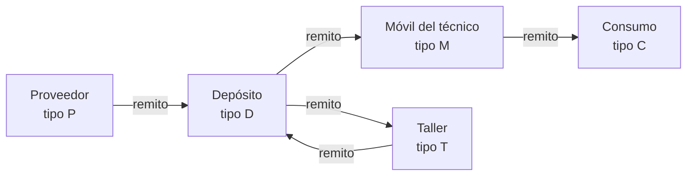
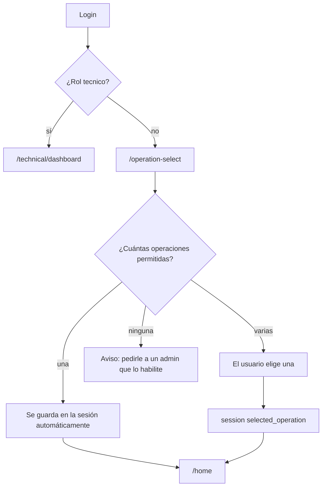
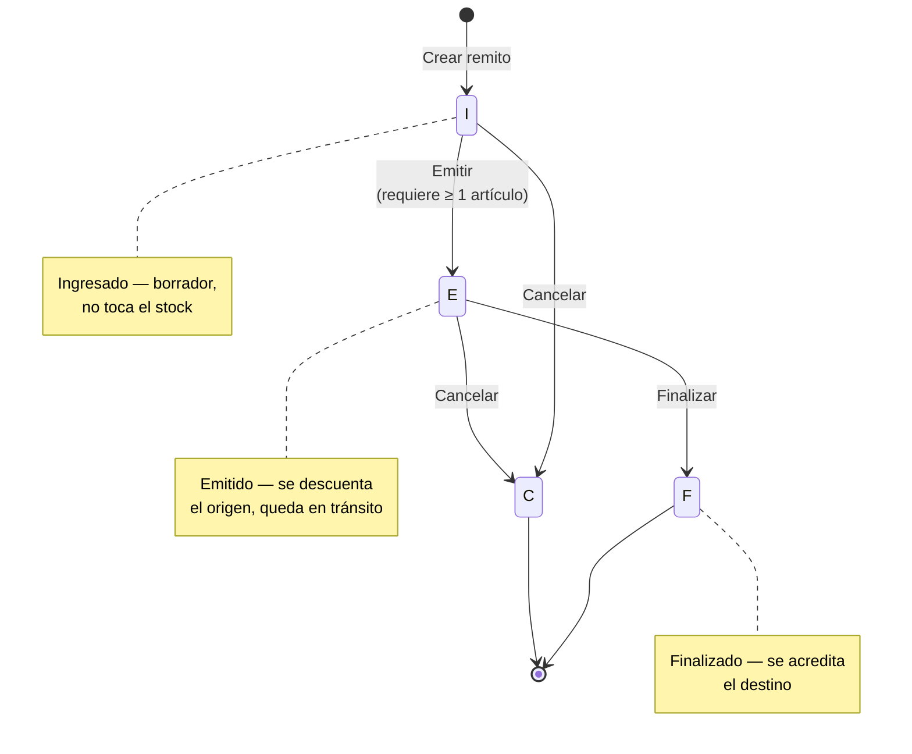

# Flujos de negocio

## Idea central

El stock **solo cambia a través de remitos**. No hay ajustes manuales de cantidad: para cargar stock inicial se hace un remito desde un centro de tipo *Proveedor*, y para dar de baja material se hace un remito hacia un centro de tipo *Consumo*.



## Inicio de sesión y selección de operación



- Las **operaciones permitidas** son las operaciones cuyo nombre coincide con algún permiso del usuario (directo o heredado del rol).
- La operación elegida se guarda en `session('selected_operation')`, solo si está entre las permitidas. Para cambiarla, se vuelve a `/operation-select`.
- Hasta elegir una operación, el middleware `checkSelectedOperation` redirige ahí desde cualquier pantalla de trabajo. También lo hace si al usuario le quitaron el permiso de la operación que tenía seleccionada. Los técnicos no pasan por este paso.
- Qué filtra la operación activa: ver [Roles y permisos](roles-y-permisos.md#qué-filtra-la-operación-activa).

## Ciclo de vida del remito



### 1. Crear la carátula (estado `I` — Ingresado)

**Remitos → Nuevo** (`GET /refer/create`, `POST /refer`).

| Campo | Regla |
|-------|-------|
| Centro de origen | Obligatorio. Cualquier centro de stock. |
| Centro de destino | Obligatorio. Cualquier centro de stock. |
| Fecha de alta (`date_up`) | Obligatoria, formato `Y-m-d H:i` (el input `datetime-local` se convierte solo). |
| Observación | Opcional, hasta 60 caracteres. |

El remito se crea en estado `I` con el usuario logueado como autor y se redirige a su detalle. La carátula se puede editar mientras no esté finalizado o cancelado; el estado no se cambia desde la edición.

### 2. Cargar artículos (movimientos)

Desde el detalle del remito, **Editar Artículos** abre `GET /movement/create/{remito}`:

- La tabla de la derecha lista el catálogo con el stock disponible en el centro de origen. Se puede filtrar por nombre, tipo y código (AJAX a `GET /api/article`).
- Los artículos marcados se pasan a la tabla del remito con **Insertar**; ahí se escribe la cantidad.
- Para quitar un renglón ya guardado, se marca su casilla de borrado.
- **Guardar** envía todo a `POST /movement`, que `MovementService::processBatchMovements` procesa renglón por renglón:
  - con `delete` marcado y un `id` existente → borra el movimiento;
  - con `id` → actualiza artículo y cantidad;
  - sin `id` → crea el movimiento;
  - los renglones sin cantidad y sin marca de borrado se ignoran.
- Al terminar se muestra un resumen ("Se eliminaron X de Y – Se actualizaron… – Se crearon…") con los errores de cada renglón, si los hubo.

La interfaz permite editar artículos mientras el remito está en `I` o en `E`. Editar un remito ya emitido deja el stock inconsistente (ver [problemas conocidos](problemas-conocidos.md#se-pueden-editar-los-artículos-de-un-remito-emitido)): conviene hacerlo solo en estado `I`.

### 3. Emitir (`I → E`)

Botón **Emitir** (`GET /refer/emited/{remito}`), desde el listado o el detalle. `ReferService::emitRefer`:

1. Exige que el remito esté en `I` y que tenga al menos un movimiento.
2. Si el origen **no** es un proveedor (`P`): por cada movimiento resta la cantidad del stock del origen (con piso en 0) y marca el movimiento como en tránsito.
3. Cambia el estado a `E`.

Todo ocurre dentro de una transacción.

### 4. Finalizar (`E → F`)

Botón **Finalizar** (`PATCH /refer/finalized/{remito}`). `ReferService::finalizeRefer`:

1. Exige que el remito esté en `E`. El botón también aparece en remitos `I`, pero en ese caso devuelve el error *"Solo se pueden finalizar remitos emitidos."*
2. Si el destino **no** es un centro de consumo (`C`): por cada movimiento suma la cantidad al stock del destino (lo crea si no existía) y saca el movimiento de tránsito.
3. Guarda `date_ended = ahora` y el estado `F`.

### 5. Cancelar (`I/E → C`)

Botón **Cancelar** (`DELETE /refer/{remito}`). No borra el remito: lo pasa a estado `C`.

- Desde `I`: solo cambia el estado.
- Desde `E`: intenta revertir el descuento. Por un error de implementación acredita el **destino** en lugar de devolver la mercadería al origen; ver [problemas conocidos](problemas-conocidos.md#cancelar-un-remito-emitido-acredita-el-destino-en-vez-de-devolver-al-origen).
- Los remitos finalizados no se pueden cancelar.

### Impacto en el stock según el tipo de centro

| Origen → Destino | Al emitir | Al finalizar | Uso típico |
|------------------|-----------|--------------|------------|
| Proveedor → Depósito | Nada | + Depósito | Compra o ingreso inicial de mercadería. |
| Depósito → Móvil | − Depósito | + Móvil | Entrega de materiales a un técnico. |
| Móvil → Consumo | − Móvil | Nada | Material usado en campo. |
| Depósito → Depósito / Taller | − Origen | + Destino | Transferencia interna. |
| Proveedor → Consumo | Nada | Nada | Sin efecto en el stock. |

**Piso en cero:** si un remito descuenta más de lo disponible, el stock queda en 0 y no se registra la diferencia. El sistema no impide emitir con stock insuficiente.

### PDF del remito

`GET /refer/get/pdf/{remito}` genera el remito imprimible (`refer/pdf.blade.php`) con la carátula y los artículos. Desde el listado se abre en un modal.

### Listado de remitos

`GET /refer` permite filtrar por origen, destino y estado. Solo muestra los remitos cuyo destino pertenece a un centro de la operación activa. Paginado de a 20, del más nuevo al más viejo.

## Mercadería en tránsito

Un remito **emitido** que todavía no fue finalizado tiene su mercadería "en tránsito": ya salió del origen y todavía no se sumó al destino.

- `GET /transit` lista esos remitos agrupados, con sus artículos.
- El ícono de transferencias de la barra superior (`movementbox`) muestra cuántos remitos hay en tránsito y un acceso a cada uno.

## Consulta de stock

- `GET /stock`: stock por centro y artículo, con filtros por centro, tipo, nombre y código. Las filas en alerta se resaltan.
- `GET /stock/{id}`: detalle de un artículo en un centro y los movimientos de remitos donde ese centro fue origen o destino. Desde acá se edita el **nivel de alerta** (`PUT /stock/{id}`; vacío o 0 desactiva la alerta).
- `GET /stock/get/pdf` y `GET /stock/get/excel`: exportan el stock con los filtros actuales.

## Alertas y notificaciones

- Un stock está **en alerta** cuando tiene `quantity_alert > 0` y `quantity <= quantity_alert`.
- Cada vez que un remito modifica un stock, o alguien cambia un nivel de alerta, se genera una notificación interna para **todos los usuarios con el permiso de la operación** a la que pertenece el centro (incluido quien hizo la operación y quienes heredan el permiso por rol).
- Las notificaciones se ven en la campana de la barra superior. Se pueden marcar como leídas o borrar, de a una o todas juntas.

Ejemplos de mensaje:
- *"El stock del artículo 'Cable UTP' en el centro 'Depósito Central' se decrementó en 50. Stock actual: 150. Límite de alerta: 100."*
- *"Se actualizó el límite de alerta para el artículo 'Cable UTP' en el centro 'Móvil 3'. Nuevo límite: 20. Stock actual: 35."*

## Portal del técnico

Pensado para usar desde el celular en la calle.

### Requisitos de configuración

1. El usuario tiene el rol `tecnico` y el permiso de su operación (por ejemplo `POP36`).
2. Tiene asignado un **centro de stock** (normalmente de tipo Móvil) en **Administración → Usuarios → Editar**.
3. La operación de ese centro tiene configurados, en **Administración → Operaciones → Editar**:
   - **Origen de solicitudes** (`request_origin_id`): el depósito que abastece a los técnicos.
   - **Destino de consumo** (`consume_destiny_id`): el centro de tipo Consumo donde se registran los consumos.

Si falta alguno de estos datos, el portal muestra un mensaje de error y no deja continuar.

### Dashboard del técnico (`GET /technical/dashboard`)

Al iniciar sesión, el técnico entra directo acá. Ve:
- **Mi Stock**: el stock de su almacén, paginado, con las filas en alerta resaltadas; desde el detalle de cada artículo puede editar su nivel de alerta.
- **Alertas de stock**: los artículos de su almacén por debajo del nivel de alerta.
- **Acciones rápidas**: *Solicitar materiales* y *Reportar consumo del día*.

### Solicitar materiales (`GET /technical/request`)

1. Busca un remito **abierto** (estado `I`) del técnico con origen = almacén de solicitudes, destino = su móvil y observación `"Solicitud de materiales"`.
2. Si no existe, lo crea.
3. Redirige a la carga de artículos de ese remito.

Mientras el despachante no lo emita, cada nueva solicitud agrega artículos al mismo remito. Después, un despachante lo **emite** (sale del depósito) y, cuando el técnico recibe el material, lo **finaliza** (entra al móvil).

### Reportar consumo del día (`GET /technical/consume`)

Igual que la solicitud, pero con origen = móvil del técnico, destino = centro de consumo y observación `"Consumo del día"`. Al emitirlo se descuenta el material del móvil; al finalizarlo no se acredita nada porque el destino es de consumo.

> Los remitos se identifican por el texto de la observación. Si alguien la edita, el portal va a crear un remito nuevo en la próxima solicitud.

## Dashboard

`GET /home` (`HomeController::index` + `DashboardService`):

| Bloque | Cálculo |
|--------|---------|
| **Resumen** | Total de artículos, de centros de stock, suma de todas las cantidades, remitos pendientes (`E`), remitos finalizados en el último mes, stocks en alerta, stocks negativos. |
| **Rotación de stock** | Suma de cantidades de los movimientos creados en los últimos 30 días ÷ stock total actual. La tendencia compara con los 30 días anteriores usando el mismo stock actual como denominador. |
| **Stock sin movimiento** | Hasta 10 stocks con cantidad > 0 de artículos que no tuvieron movimientos en ningún centro en los últimos 6 meses, de mayor a menor cantidad. |
| **Eficiencia de despacho** | Promedio, mínimo y máximo de horas entre `date_up` y `date_ended` de los remitos finalizados. La tendencia compara con los finalizados entre 60 y 30 días atrás. |
| **Recomendaciones** | Avisos por prioridad: stock negativo, stock sin movimiento, stocks en alerta, remitos emitidos hace más de 7 días, artículos sin stock en ningún centro. |
| **Gráfico de movimientos** | Cantidad movida por artículo en los remitos con `date_up` en el rango elegido (por defecto, el último mes), con filtro opcional de origen y destino. Se dibuja con Chart.js. |

Como la lógica de remitos no deja el stock por debajo de 0, el indicador de stock negativo solo detecta datos cargados por fuera del sistema.

## Reportes

| Reporte | Ruta | Filtros | Contenido |
|---------|------|---------|-----------|
| Stock (PDF) | `GET /stock/get/pdf` | Centro, tipo, nombre, código | Listado de stock con totales de registros, en alerta y agotados. |
| Stock (Excel) | `GET /stock/get/excel` | Centro, tipo, nombre, código | Una fila por stock, con estado OK/ALERTA. |
| Movimientos (Excel) | `GET /home/reportAllMovement` | Rango de fechas (obligatorio) | Movimientos de los remitos **finalizados** en el rango, con origen, destino, artículo, cantidad, estado y usuario. |
| Consumo por artículo (Excel) | `GET /home/reportRpFyS` | Rango de fechas (obligatorio), orígenes y destinos (opcionales, múltiples) | Cantidad total por artículo de los remitos finalizados en el rango que cumplen los filtros. |
| Remito (PDF) | `GET /refer/get/pdf/{id}` | — | Remito imprimible. |

Los reportes de movimientos y consumo se piden desde el bloque de reportes del dashboard.

## Importación masiva (CSV)

**Administración → Importar** (`GET/POST /importar`, solo rol admin). Sirve para la carga inicial de artículos, personas o direcciones.

Formato del archivo:
- Extensión `.csv` o `.txt`, columnas separadas por **punto y coma (`;`)**.
- La primera fila es la cabecera y se ignora.
- Las columnas van en el orden indicado; los nombres de la cabecera no se validan.

| Tipo | Columnas (en orden) | Obligatorias |
|------|---------------------|--------------|
| Artículos | `name;code;unit;type` | `name` (≤ 60), `unit` (1 carácter) |
| Personas | `name;surname;email;cuit;telephone` | `name` (≤ 60) |
| Direcciones | `country;state;city;locality;street;number;department;house;floor;cp` | todas salvo `department`, `house` y `floor` |

Ejemplos:

```csv
nombre;codigo;unidad;tipo
"Tornillo Phillips 3x15mm, cabeza plana";T001;U;Ferretería
```

```csv
pais;provincia;ciudad;localidad;calle;numero;departamento;casa;piso;cp
"Argentina";"Buenos Aires";"CABA";"Palermo";"Av. Santa Fe";1234;"A";"";"5";1425
```

La importación es **todo o nada**: corre en una transacción y, si una fila falla la validación, no se importa ninguna y se informa el número de fila y el error. No detecta duplicados: importar dos veces el mismo archivo duplica los registros.

## Datos maestros

| Módulo | Ruta | Notas |
|--------|------|-------|
| Artículos | `/article` | Nombre, código, unidad (U/M/K), tipo. |
| Personas | `/person` | En el menú figuran como "Técnicos". Nombre, apellido y email obligatorios; CUIT y teléfono numéricos. |
| Direcciones | `/direction` | País y provincia desde listas (`countries.json`); el resto es texto o número. |
| Centros de stock | `/stockcenter` | Operación, nombre, tipo, dirección (obligatoria) y persona responsable (opcional). |
| Operaciones | `/operation` | Solo admin. Al crear una operación se crea el permiso homónimo; también se configuran los centros del portal técnico. |
| Usuarios | `/admin/users` | Solo admin. Ver [Roles y permisos](roles-y-permisos.md#gestión-de-usuarios). |

La aplicación también incluye un manual de uso para usuarios finales en `GET /howtouse`.
