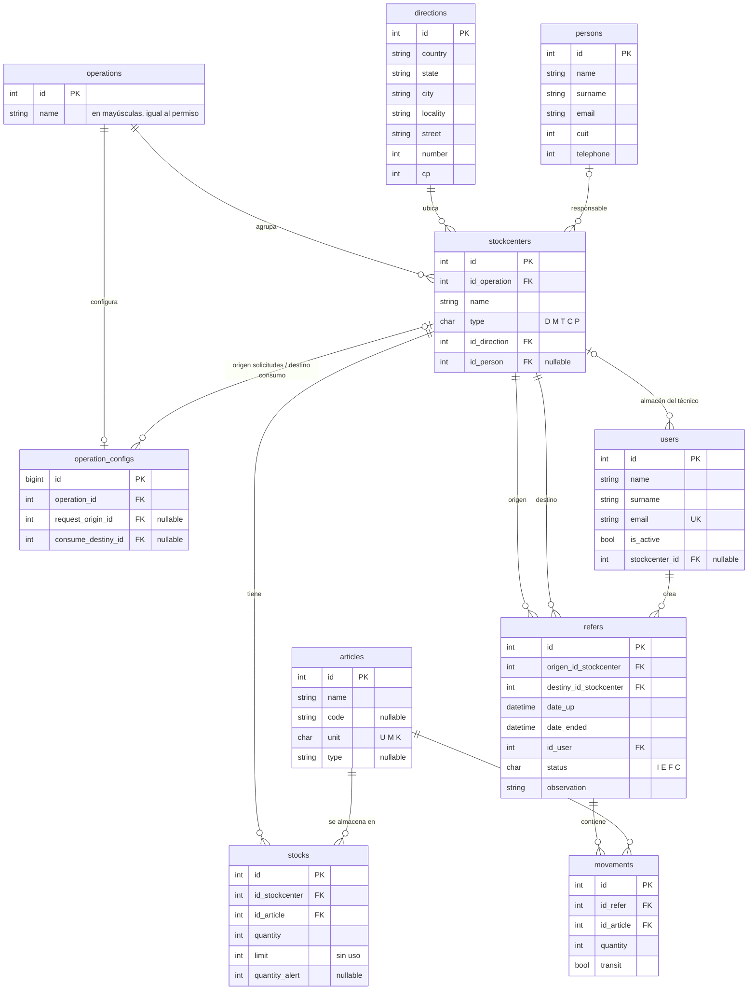

# Modelo de datos

El esquema se define en `database/migrations/`. Las claves primarias de las tablas propias son `INT UNSIGNED AUTO_INCREMENT` (`increments`), salvo `operation_configs` y las tablas de paquetes, que usan `BIGINT`. Las claves foráneas siguen la convención `id_<entidad>` (por ejemplo `id_article`), excepto en las tablas más nuevas (`stockcenter_id`, `operation_id`).

## Diagrama entidad-relación

## Tablas de negocio

### `operations` — Operaciones

| Columna | Tipo | Notas |
|---------|------|-------|
| `id` | int | PK |
| `name` | varchar(255) | El modelo lo pasa a mayúsculas al guardar. Tiene que coincidir con el nombre de un permiso de Spatie (ver [Roles y permisos](roles-y-permisos.md)). |

Modelo `Operation`: `config()` → `hasOne(OperationConfig)`.

### `operation_configs` — Configuración del portal técnico por operación

| Columna | Tipo | Notas |
|---------|------|-------|
| `id` | bigint | PK |
| `operation_id` | int | FK → `operations`, `ON DELETE CASCADE` |
| `request_origin_id` | int, nullable | FK → `stockcenters`, `ON DELETE SET NULL`. Almacén desde el que salen los materiales que piden los técnicos. |
| `consume_destiny_id` | int, nullable | FK → `stockcenters`, `ON DELETE SET NULL`. Centro de tipo consumo al que van los consumos que reportan los técnicos. |

Modelo `OperationConfig`: `operation()`, `requestOrigin()` y `consumeDestiny()`.

### `stockcenters` — Centros de stock

| Columna | Tipo | Notas |
|---------|------|-------|
| `id` | int | PK |
| `id_operation` | int | FK → `operations`, `ON DELETE CASCADE` |
| `name` | varchar(60) | |
| `type` | char(1) | Ver [tipos de centro](#tipos-de-centro-de-stock). |
| `id_direction` | int | FK → `directions`, `ON DELETE CASCADE`. Obligatorio. |
| `id_person` | int, nullable | FK → `persons`, `ON DELETE CASCADE`. Persona responsable. |

Modelo `Stockcenter`: no declara `$fillable` (el controlador usa `insert`/`update` por query builder). Relaciones con nombres en mayúscula: `Operation()`, `Direction()`, `Person()`. También tiene:
- `scopeOperationSelect($query, array $nombres)`: filtra por operaciones con esos nombres; si no encuentra ninguna, no filtra.
- `ValidateIDRel($request)`: anula los IDs de dirección, operación o persona que no existen antes de validar.
- `TypeOf()`: reemplaza el código de tipo por su nombre (muta el atributo, solo para mostrar).

### `articles` — Artículos

| Columna | Tipo | Notas |
|---------|------|-------|
| `id` | int | PK |
| `name` | varchar(60) | |
| `code` | varchar(12), nullable | Código interno. |
| `unit` | char(1) | `U`, `M` o `K`; el modelo lo pasa a mayúsculas. |
| `type` | varchar(30), nullable | Categoría libre (por ejemplo "Ferretería"). |

Modelo `Article`: atributo calculado `unit_name` (Unidad, Metro o Kilogramo), *scopes* `name`, `type` y `code` (búsqueda con `LIKE`), relación `stocks()`.

### `stocks` — Existencias por centro

| Columna | Tipo | Notas |
|---------|------|-------|
| `id` | int | PK |
| `id_stockcenter` | int | FK → `stockcenters`, `ON DELETE CASCADE` |
| `id_article` | int | FK → `articles`, `ON DELETE CASCADE` |
| `quantity` | int, default 0 | Cantidad actual. La lógica de remitos nunca la deja bajar de 0. |
| `limit` | int, nullable | Agregada en 2022-09; no se usa. |
| `quantity_alert` | int, nullable | Nivel de alerta. `0` o `null` desactiva la alerta. |

No hay índice único sobre (`id_stockcenter`, `id_article`): la unicidad depende de que la aplicación use `firstOrNew`. Los registros de stock se crean solos la primera vez que un remito mueve un artículo hacia o desde un centro.

Modelo `Stock`: atributo calculado `warning` (verdadero si `quantity_alert > 0` y `quantity <= quantity_alert`), *scopes* `stockCenters`, `articles`, `type`, `code`, `withRelations` y `orderDefault`.

### `refers` — Remitos

| Columna | Tipo | Notas |
|---------|------|-------|
| `id` | int | PK. Es el número de remito. |
| `origen_id_stockcenter` | int | FK → `stockcenters`, `ON DELETE CASCADE` |
| `destiny_id_stockcenter` | int | FK → `stockcenters`, `ON DELETE CASCADE` |
| `date_up` | datetime, nullable | Fecha de alta que carga el usuario. |
| `date_ended` | datetime, nullable | Se completa al finalizar. |
| `id_user` | int | FK → `users`, `ON DELETE CASCADE`. Quien creó el remito. |
| `status` | char(1), default `I` | Ver [estados del remito](#estados-del-remito). |
| `observation` | varchar(255), nullable | El formulario la limita a 60 caracteres. El portal técnico la usa para identificar los remitos abiertos ("Solicitud de materiales", "Consumo del día"). |

Modelo `Refer`: relaciones `origin()`, `destiny()`, `user()` y `movements()`. Agrega al JSON los atributos calculados `status_name`, `full_name_user`, `name_origin`, `name_destiny`, `created_at_formatted`, `date_ended_formatted` y `date_up_formatted` (fechas en `d/m/Y`). *Scopes*: `stockCenterOrigin`, `stockCenterDestiny`, `stockCenterInDestiny`, `status`, `fechaCreado` y `fechaFinalizado`.

### `movements` — Renglones de remito

| Columna | Tipo | Notas |
|---------|------|-------|
| `id` | int | PK |
| `id_refer` | int | FK → `refers`, `ON DELETE CASCADE` |
| `id_article` | int | FK → `articles`, `ON DELETE CASCADE` |
| `quantity` | int, default 0 | |
| `transit` | boolean, default false | Se pone en verdadero al emitir y en falso al finalizar (si el destino no es consumo). |

Modelo `Movement`: `refer()`, `article()`, `markAsInTransit()` y `markAsOutTransit()`. Los métodos `setQuantityOrigen()`/`setQuantityDestiny()` y los campos `quantity_origen`/`quantity_destiny` del `$fillable` no tienen columna en la base (ver [problemas conocidos](problemas-conocidos.md)).

### `persons` — Personas

| Columna | Tipo | Notas |
|---------|------|-------|
| `name` | varchar(60) | El modelo capitaliza cada palabra. |
| `surname` | varchar(60), nullable | Ídem. |
| `email` | varchar(200), nullable | |
| `cuit` | int, nullable | Un INT no alcanza para un CUIT de 11 dígitos (ver [problemas conocidos](problemas-conocidos.md)). |
| `telephone` | int, nullable | |

Atributo calculado `full_name`.

### `directions` — Direcciones

`country`, `state` (provincia), `city`, `locality`, `street` (varchar), `number` (int), `department`, `house` y `floor` (varchar cortos, nullable), y `cp` (int). El modelo capitaliza `city`, `locality` y `street`. Atributo calculado `full_direction` ("calle número").

### `users` — Usuarios

Tabla estándar de Laravel con estas columnas extra:

| Columna | Tipo | Notas |
|---------|------|-------|
| `surname` | varchar | |
| `is_active` | boolean, default true | Si es falso, el middleware `checkIfUserIsActive` le cierra la sesión. |
| `stockcenter_id` | int, nullable | FK → `stockcenters`, `ON DELETE SET NULL`. Almacén móvil del técnico. |

Modelo `User`: traits `HasRoles` (Spatie), `HasApiTokens` (Sanctum) y `Notifiable`; implementa `JWTSubject`. Métodos: `allowedOperations()`, `stockcenter()` y *scopes* `active` e `inactive`.

## Tablas de paquetes y del framework

| Tabla | Origen |
|-------|--------|
| `permissions`, `roles`, `model_has_permissions`, `model_has_roles`, `role_has_permissions` | Spatie Permission (sin *teams*). |
| `notifications` | Notificaciones de Laravel (canal `database`). |
| `personal_access_tokens` | Sanctum (instalado, sin uso real). |
| `password_resets` | Laravel (el reseteo de contraseña está deshabilitado en las rutas). |
| `failed_jobs` | Cola de Laravel. |
| `operation` (singular) | Migración `2024_11_13_194735` duplicada; la tabla no se usa. |

## Códigos

### Estados del remito

| Código | Nombre | Significado |
|--------|--------|-------------|
| `I` | INGRESADO | Borrador. Se pueden editar la carátula y los artículos. No afecta el stock. |
| `E` | EMITIDO | La mercadería salió del origen (stock descontado) y está en tránsito. |
| `F` | FINALIZADO | La mercadería llegó al destino (stock acreditado). Estado final. |
| `C` | CANCELADO | Anulado. Estado final. |

### Tipos de centro de stock

| Código | Nombre | Comportamiento especial |
|--------|--------|-------------------------|
| `D` | DEPÓSITO | — |
| `M` | MÓVIL | Almacén de un técnico (vehículo). |
| `T` | TALLER | — |
| `C` | CONSUMO | Destino "sumidero": al finalizar un remito hacia un centro de consumo no se acredita stock. No aparece en el selector de centros de la pantalla de stock. |
| `P` | PROVEEDOR | Origen "fuente": al emitir un remito desde un proveedor no se descuenta stock. No aparece en el selector de centros de la pantalla de stock. |

### Unidades de artículo

| Código | Nombre |
|--------|--------|
| `U` | Unidad |
| `M` | Metro |
| `K` | Kilogramo |

## Borrados en cascada

Varias claves foráneas usan `ON DELETE CASCADE`, así que **borrar un registro maestro puede eliminar historial**:

- Borrar una **operación** borra sus centros de stock y, por cascada, sus stocks, los remitos que los usan como origen o destino, y los movimientos de esos remitos.
- Borrar una **dirección** o una **persona** borra los centros de stock que la referencian, con el mismo efecto en cadena.
- Borrar un **artículo** borra su stock en todos los centros y todos los movimientos donde aparece.
- Borrar un **usuario** borra los remitos que creó.

Los controladores no piden confirmación extra ni validan dependencias antes de borrar. Antes de eliminar datos maestros en producción, conviene hacer un respaldo.
